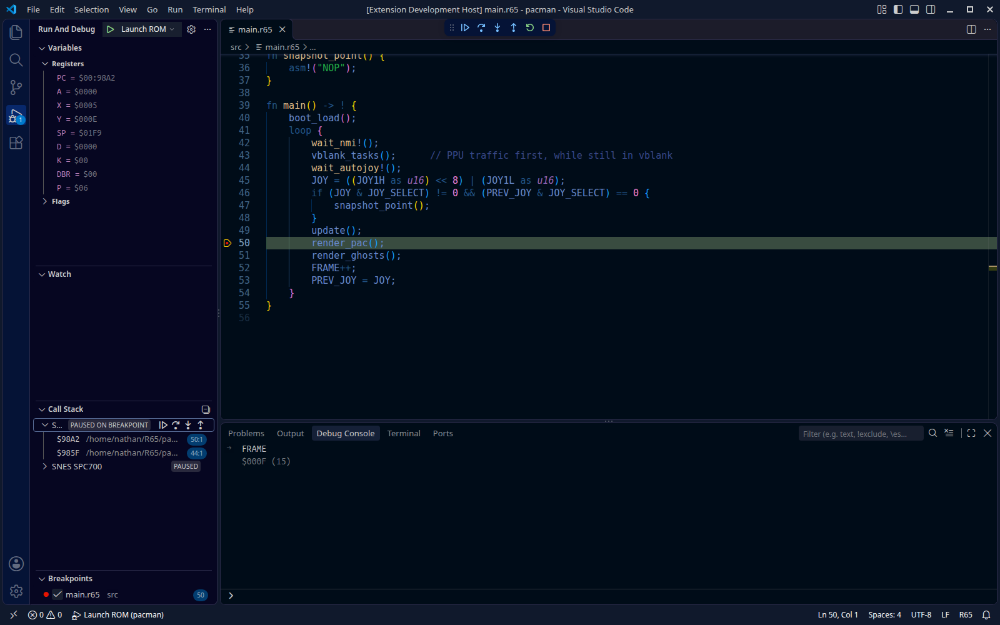

# XRetroCode

Source-level debugging of retro console games in VS Code, plus language support
for the [R65](https://github.com/BubbleZapGames/R65) compiler.

XRetroCode is a VS Code extension (`xretrocode/`) that drives
[Mesen-GDB](https://github.com/BubbleZapGames/Mesen-GDB) over the Debug Adapter
Protocol. Mesen-GDB runs the ROM on Mesen2's emulation core and maps addresses
back to source lines through the compiler's `.dbg` symbols. You set breakpoints
in source, step, and inspect registers and memory from the VS Code debugger.



Mesen-GDB emulates NES, SNES, Game Boy, Game Boy Advance, PC Engine,
SMS/Game Gear and WonderSwan. SNES with R65 is the most complete path.

## Features

**Debugging**

- Launch a ROM. A workspace with a single ROM starts with no configuration,
  and a workspace with several shows a picker.
- Breakpoints in `.r65` source, including conditional breakpoints evaluated by
  Mesen's expression engine
- Step over, in and out, pause and continue. Each emulated CPU appears as its
  own thread.
- Registers, flags and memory in the Variables view, plus expression evaluation
  in the Debug Console
- Runs `make` before launching when the workspace has a makefile
- Headless mode with no game window, for CI and remote sessions
- **Go to Macro Definition** for macros on the stopped line. The debugger steps
  over macro expansions, so this takes you to their source.

**R65 language**

- Syntax highlighting
- Go to Definition, Find All References, hover, completion, the Outline view and
  workspace symbol search (Ctrl+T)
- `r65c` build and check tasks with a problem matcher

## Repository layout

| Path | Contents |
|---|---|
| `xretrocode/` | The VS Code extension (TypeScript) |
| `Mesen-GDB/` | Submodule: the emulator and its DAP server (C++) |

## Getting started

### 1. Get mesen-gdb

Download a build from
[Mesen-GDB releases](https://github.com/BubbleZapGames/Mesen-GDB/releases):

- **Linux** (`linux-x64.tar.gz`): needs SDL2 installed (`libsdl2-2.0-0` on
  Debian/Ubuntu).
- **Windows** (`windows-x64.zip`): a single self-contained `mesen-gdb.exe`.
- **macOS** (`macos-arm64.tar.gz` for Apple Silicon, `macos-x64.tar.gz` for
  Intel; macOS 11 or later): self-contained. The binary is unsigned, so clear
  the quarantine once after unpacking:

  ```bash
  tar -xzf mesen-gdb-*-macos-*.tar.gz
  xattr -d com.apple.quarantine mesen-gdb
  ```

Put `mesen-gdb` on your `PATH`, or set `xretrocode.mesenDapPath` to it.

The extension looks for `mesen-gdb` in this order:

1. `mesenDapPath` in `launch.json`
2. The `xretrocode.mesenDapPath` setting
3. A build under `Mesen-GDB/bin/linux-x64/{Release,Debug}/`, next to the
   workspace or the extension
4. `PATH`, then `/usr/local/bin`, `/usr/bin` and `~/.local/bin`

If none of these turns up a binary, the extension offers to download one or
lets you browse for it. It remembers the binary you pick.

### 2. Install the extension

Package it as a `.vsix` and install that:

```bash
cd xretrocode
npm install
npm run package                                # → xretrocode-0.0.1.vsix
code --install-extension xretrocode-0.0.1.vsix
```

You can also install it from the Extensions view: open the `...` menu and
choose **Install from VSIX...**. The package doesn't include `mesen-gdb`.
Install that separately, as described in step 1.

To run the extension in development, open `xretrocode/` in VS Code and press F5.

### 3. Debug a ROM

Open your game's folder and press F5. To pin the ROM or other options, add a
launch configuration:

```json
{
  "name": "Launch ROM",
  "type": "xretrocode",
  "request": "launch",
  "romPath": "${workspaceFolder}/build/game.sfc",
  "stopOnEntry": true
}
```

| Attribute | Default | Description |
|---|---|---|
| `romPath` | prompt | ROM to load. If empty or `${command:xretrocode.pickRom}`, you are prompted to choose one. |
| `dbgPath` | auto | `.dbg` symbol file. Defaults to the ROM name with `.dbg`, then `<rom dir>/main.dbg`. |
| `stopOnEntry` | `true` | Break at the entry point |
| `headless` | `false` | Run without the game window |
| `mesenDapPath` | auto | Path to `mesen-gdb`, overriding the setting |

## Settings

| Setting | Default | Description |
|---|---|---|
| `xretrocode.mesenDapPath` | `""` | Path to `mesen-gdb` |
| `xretrocode.buildBeforeLaunch` | `true` | Run `make` before each debug session when the folder has a makefile |
| `r65.compilerPath` | `r65c` | R65 compiler |
| `r65.includePaths` | `[]` | Extra include search paths |
| `r65.targetPlatform` | `snes` | `snes` or `nes` |
| `r65.cfgOptions` | `[]` | Conditional compilation options, e.g. `["snes", "debug"]` |

## Testing

```bash
cd xretrocode
npm test                      # unit tests against a mocked vscode API
xvfb-run -a npm run test:e2e  # real VS Code + mesen-gdb on Mesen-GDB's test ROM
```

The e2e suite needs a built `mesen-gdb` (run `make` in `Mesen-GDB/`). It
downloads VS Code into `.vscode-test/` unless `VSCODE_EXECUTABLE` points at an
installed copy, e.g. `VSCODE_EXECUTABLE=/usr/share/code/code`.

Mesen-GDB's C++ tests, including the DAP server, run with `make test` in
`Mesen-GDB/`.

## License

Apache License 2.0. See [LICENSE](LICENSE).
